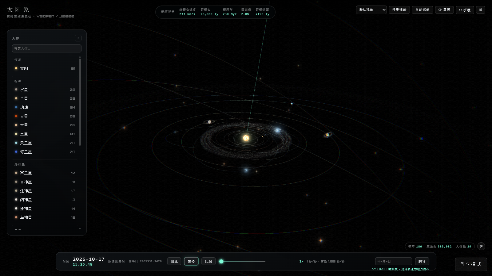

<div align="center">

# SOLAR SYSTEM · 3D Solar System

[简体中文](./README.md) · **English**

A zero-setup single-page 3D solar system: eight planets driven by VSOP87 J2000 element series, the whole system orbiting the galactic centre, a sci-fi monochrome HUD and a Chinese/English UI. Everything is bundled locally — **nothing is fetched at runtime**.

[](https://github.com/Yiyazadxr/SolarSystem-Model/stargazers)
[](./LICENSE)
[](https://threejs.org)
[-brightgreen?style=flat-square)](#run)
[](#run)
[](#tech-stack)

[Code of Conduct](./CODE_OF_CONDUCT.md) · [Security](./SECURITY.md) · [Open an issue](https://github.com/Yiyazadxr/SolarSystem-Model/issues) · [Contributing](./CONTRIBUTING.md) · [License](#license)

<p align="center">
  
</p>

</div>

---

## Features

- **Real bodies** 🪐 — Sun, eight planets, Pluto, 11 major moons, the asteroid belt, the Kuiper belt and comet 1P/Halley. The eight planets use VSOP87 element series (Earth's orbit is the Earth–Moon barycentre); other bodies use JPL approximate elements
- **Procedural rendering** ☀️ — Granulation, limb darkening, sunspots and corona on the Sun; bumps, zonal bands, the Great Red Spot, Fresnel atmosphere glow, sunset colour, ring shadows and eclipse shadows on planets — all hand-written GLSL
- **Galactic orbit and trail** 🌌 — The system orbits the galactic centre along the galactic plane at its **true 60.2° tilt** (233 km/s, one galactic year ≈ 50 minutes). The Sun's actual path (with precession and oscillation) is always drawn and brightens slightly as the camera pulls back
- **Two display scales** 📏 — **Compact** (default) and **Faithful**, switchable at any time; only distance and size mappings change, orbital periods and lighting relations stay the same. Each body's compression factor is listed in its info card, and the per-unit scale facts appear under the SCALE row in settings
- **Time and camera** ⏱️ — 10 speed steps from 1× up to 1e9×, time reversal and date jump; cursor-targeted wheel zoom, cinematic flights, soft follow, cruise, 5 preset views and planet alignment. Flight distance is split evenly across each order of magnitude (log₁₀) and duration grows with every decade crossed, capped at 5 s (3.5 s in faithful); the lift arc only appears when the two subjects are far enough apart
- **Interface** 🖥️ — Searchable body navigator, a 9-section info card, settings panel, Bloom / scanlines / vignette / grain post-processing, four quality tiers `ULTRA / HIGH / MEDIUM / LOW`, fully bilingual
- **Procedural audio** 🔊 — Three Web Audio cues (select / mode switch / toggle) synthesised in real time, no audio files, no network; on by default, switchable in settings (the switch is stored in localStorage)
- **Teaching mode** 🎓 — Entry at the bottom-right; chapter 3 covers "Knowing the Earth", the solar system, Earth's rotation and Sun–Earth–Moon motion — 19 steps in total, isolated from demo mode

## Teaching mode

A classroom walkthrough mode, **kept apart from demo mode**: enter via "Teaching mode" at the bottom-right, leave with `Esc` or "Demo mode".

- **Navigation**: chapter → section → subsection → step; chapter 3 currently has 19 steps, `←` `→` `空格` to page through
- **Rigs**: globe, orrery (Sun–Earth–Moon), ground-based sundial scene and a simple Earth–Moon model; routes, ships and eclipse shadows are all procedural — nothing is fetched at runtime
- **Schematic scale**: teaching rigs all use a schematic scale; the observed relations and animation directions are preserved
- **Isolation**: on entry it locks HIGH quality, disables auto quality changes, freezes the demo time system and hides the main HUD; everything is restored on exit. The UI targets smart boards and projectors (body text ≥20px, buttons ≥44px)

## Run

**Double-click `index.html`** and you are done (recommended). Textures are embedded as base64, so it loads over `file://` with no server.

If your browser restricts `file://`, serve the folder locally: `python -m http.server 8080` (run it from the project root).

> [!NOTE]
> A desktop browser with WebGL is required. If WebGL is unavailable, the loading screen shows a bilingual notice instead of a blank page.

> [!TIP]
> `assets/js/textures/` chunks and `assets/js/textures-manifest.js` are generated. After changing images under `assets/textures/`, run `node scripts/generate-textures.js` to re-embed them (`--check` verifies consistency); new images must be grouped in the script's `GROUPS` or generation fails. `textures-loader.js` injects the chunks once the loading screen is visible, so the full base64 payload is never parsed synchronously on first paint.

`assets/js/vsop87.js` is generated as well. The original IMCCE files live in `assets/vsop87/`; `node scripts/generate-vsop87.js --check` verifies the data offline against 80 official reference sets.

## Shortcuts

| Key | Action | Key | Action |
| --- | --- | --- | --- |
| `Space` | Play / pause | `R` | Reset view |
| `↑` `↓` | Speed up / down | `H` | Immersive mode (hide HUD) |
| `←` `→` | Cycle bodies in alignment mode | `/` | Focus the search box |
| `?` | Shortcut overlay | `Esc` | Close settings → overlay → search → deselect |

## Tech stack

- **Rendering**: Three.js r150.1 (official UMD build in `assets/vendor/three.min.js`, `THREE.REVISION === '150'`) on WebGL1 / WebGL2
- **Materials**: every material is hand-written GLSL `ShaderMaterial` (planet surfaces, atmospheres, corona, star points, trails, comet tails, rings)
- **Post-processing**: `EffectComposer` with a layered `UnrealBloomPass` (emissive objects render to half-resolution RTs) plus a custom finishing `ShaderPass` (vignette / scanlines / chromatic aberration / grain)
- **Astronomy**: VSOP87 element series for the eight planets, Kepler solver (Newton iteration with bisection fallback), JPL / SBDB approximate elements for other bodies, Julian date conversion
- **Engineering**: no build step, ES5, IIFEs, a single `window.SOLAR` namespace, base64-embedded assets. `scene` / `ui` / `teach-globe` are split into layered files behind unchanged façades (`SOLAR.Scene` / `SOLAR.UI` / `SOLAR.TeachGlobe`)

## Directory layout

```
.
├── index.html                 Single-page entry (HUD markup, loading animation, script wiring)
├── assets/
│   ├── css/                   HUD and teaching styles
│   ├── js/                    41 modules, load order = dependency order
│   │   ├── core                 config / data / i18n / audio / vsop87 / astro / textures-manifest / textures-loader / effects
│   │   ├── scene                scene-shaders / scene-shared / scene-gfx / scene-sun / scene-bodies / scene-backdrop / scene (façade)
│   │   ├── systems              galaxy / controls
│   │   ├── interface            ui-shared / ui-util / ui-fx / ui-dom / ui-nav / ui-info / ui-settings / ui-time / ui-shell / ui (façade)
│   │   ├── main loop            main
│   │   └── teaching             teach-data / teach-globe-* / teach-orrery / teach-ground / teach-moonsync / teach-scenes / teach
│   ├── vsop87/                Original IMCCE element files and checksums (offline generation only)
│   └── textures/ vendor/      25 textures (chunk-embedded into assets/js/textures/); Three.js r150 + OrbitControls + post-processing
├── scripts/                   Texture generation + zero-dependency checks (syntax / ES5 / offline / load order / i18n / data / assets / startup / orbit inset / teach data / teach camera / teach collapse / DOM refs / doc counts)
├── docs/screenshots/          README screenshots
├── .github/ISSUE_TEMPLATE/    Issue forms (bug report / feature request)
└── AGENTS.md · CLAUDE.md · CODE_OF_CONDUCT.md · CONTRIBUTING.md · LICENSE · NOTICE · README.md · README.en.md
```

Module responsibilities are mapped in [AGENTS.md](./AGENTS.md); boundaries are:

| Group | Files (load order) | Façade / public contract |
| --- | --- | --- |
| Scene | `scene-shaders.js` → `scene-shared.js` → `scene-gfx.js` → `scene-sun.js` → `scene-bodies.js` → `scene-backdrop.js` → `scene.js` | `SOLAR.Scene` |
| UI | `ui-shared.js` → `ui-util.js` → `ui-fx.js` → `ui-dom.js` → `ui-nav.js` → `ui-info.js` → `ui-settings.js` → `ui-time.js` → `ui-shell.js` → `ui.js` | `SOLAR.UI` |
| Teach globe | `teach-globe-shared.js` → `teach-globe-shaders.js` → `teach-globe-body.js` → `teach-globe-scenes.js` → `teach-globe-apply.js` → `teach-globe.js` | `SOLAR.TeachGlobe` |

The split only changed internal structure: cross-module calls go through runtime-qualified names, shared state lives in each `*Shared` file, and cross-cutting per-frame `update` logic stays in the façades. A new file must be added to both `index.html` and `EXPECTED_ORDER` in `scripts/check-script-order.js`, or the load-order check fails.

## Data sources

| Item | Source |
| --- | --- |
| Planetary elements and perturbation terms | JPL / NASA *Keplerian Elements for Approximate Positions of the Major Planets* |
| Eight-planet demo orbits | IMCCE / Bretagnon & Francou (1988) VSOP87 main version (Earth orbit uses the EMB) |
| Satellite orientation elements (Ω / ω / M₀) | JPL *Planetary Satellite Mean Elements* (epoch 2000-01-01.5 TDB) |
| Physical parameters, dwarf planet / comet elements | NASA Planetary Fact Sheets, IAU and IAU Minor Planet Center |
| Planet and moon textures | NASA / USGS Astrogeology (public domain), Solar System Scope (CC BY 4.0) |
| Milky Way structure parameters | Published review values (R₀ ≈ 8 kpc, pitch angle ≈ 13°, v ≈ 220 km/s) |

Per-item details are in [NOTICE](./NOTICE). Values are educational-grade approximations, not measurement-grade.

## Performance

- 180 FPS cap; the frame accumulator does not drift, dt is clamped, rendering pauses when the tab is hidden
- Adaptive quality: one window per 90 frames; window average < 40 FPS for 2 windows in a row degrades one tier; the upgrade line is min(65 FPS, 95% of the session's peak window average) so 60 Hz displays are not pinned by vsync — 3 high windows in a row upgrade one tier, with a 4 s cooldown. After a manual pick the scene never auto-upgrades, but auto-degrade stays as a fallback
- Layered Bloom: emissive objects render to a half-resolution RT with planets as occluders; near the Sun only the strength is lowered and highlight compression raised (ULTRA / HIGH / MEDIUM; off in LOW)
- Zero `new` per frame, hover picking throttled to ~70 ms, trails updated incrementally via `drawRange`

Geometry cost with the whole scene in view: ULTRA 292,998 / HIGH 109,894 / MEDIUM 76,518 / LOW 44,889 triangles; HIGH is the default (pixel ratio 2, Bloom 0.95 / 0.62 / 0.10). LOW also disables Bloom, scanlines, vignette and motion trails. If it stutters, switch to Medium / Low manually; on 4K or high-DPI screens Bloom costs several full-screen passes, so dropping one tier helps.

## Compatibility and validation

| Item | Requirement / notes |
| --- | --- |
| Graphics API | **WebGL 1** (probed as `webgl` → `experimental-webgl` → `webgl2`). If unavailable, the loading screen shows a bilingual notice and stops |
| Scripts / interaction | ES5 + IIFEs, no modules / transpiling / frameworks; Pointer Events; `backdrop-filter` with the `-webkit-` prefix |
| Readings / network / storage | Memory reading relies on `performance.memory` (**Chromium only**); no external requests at runtime, no cookies; only the audio switch is stored in `localStorage` (browsers that block storage simply do not remember it — everything still works) |
| Resolution | Designed for about 1100×700 and up; mobile is not supported |

**Validation status**: all script checks run in Node; the main demo paths have been smoke-tested in a **headless Chromium environment** (SwiftShader software rendering). Full visual and interaction regression is done by eye, and the step-by-step visual regression of the teaching scenes is still pending. **Firefox / Safari and real-GPU environments have not been tested.**

The VSOP87 series matches the official IMCCE main version to a maximum difference of 4.975e-11 across 80 epochs × 6 elements; the generated file keeps 23,103 terms (942,392 B) with a maximum single-element deviation of 1.206e-5 from the full series on a J2000 ±4,000 year grid (a in AU, angles in radians).

**Reproducibility**: the procedural starfield, asteroid belt and Kuiper belt are driven by a fixed seed (`config.procedural.seed`, a small LCG in `scene-gfx.js`, independent of `Math.random`). Every load is identical; add `#seed=1234` to the URL (or call `SOLAR.Scene.setProceduralSeed(n)`) to deterministically reshuffle the particles. When comparing screenshots or doing pixel statistics, record the seed — otherwise the result cannot be reproduced.

## Known limitations

- No reliable public source for Callisto, so it falls back to procedural rendering; the Uranian rings are drawn procedurally (`uranus_ring.webp`, see NOTICE)
- Under `file://` no on-disk textures are requested (CORS); everything goes through the embedded base64, missing images have fallbacks, and the console stays clean
- The official r150 UMD `three.min.js` prints one deprecation warning about the r160 removal of `build/three.min.js`; it ships with the file. Console smoke checks allow this single line, any other new warning/error still needs to be fixed
- Demo mode **cannot reach a strict 1:1 scale** (would need a logarithmic depth buffer; see `config.js`): the faithful tier comes close, but the body radius-to-orbit ratio is still compressed (about 40× for Earth), and the outer system extends past the galactic-centre distance markers (derivation in `config.js` → `profiles.faithful`)
- At the top speed (1e9) a single step advances at most 4 simulated days; outer planets still show a slight stepping feel — a deliberate smoothing trade-off
- The Milky Way is an **observation-based procedural statistical model**, not a reconstruction from real survey catalogues
- VSOP87 main-version Earth is the Earth–Moon barycentre, not the geocentre; the UI clock treats UTC as TT and has no ΔT model. The shared 1″ reference span of the official series is J2000 ±2,000 years, which the truncated version does not inherit; outside it the app keeps computing and shows a hint. Pluto, dwarf planets, comets and moons keep their own approximate models
- No mobile/touch support, no screenshot export, and camera state is not written into the URL
- Audio is three short cues with no background music, **on by default** (can be muted in settings); where `file://` blocks `localStorage`, the switch does not persist

## Size

124 files in the repository (git view, ignoring `.gitignore` entries), about 30 MB: `assets/js/` ≈ 12.6 MB (including ≈ 10.9 MB of base64 texture chunks), `assets/textures/` ≈ 8.2 MB (25 textures), `assets/vendor/` 0.6 MB, everything else under 1 MB. `assets/js/` holds 41 modules; the extra files from the `scene` / `ui` / `teach-globe` split are plain source with negligible total size.

## License

Code and assets are licensed separately; see [LICENSE](./LICENSE) and [NOTICE](./NOTICE).

- **Source code**: [MIT](./LICENSE) © 2026-present Yiyazadxr — modify, use commercially and redistribute freely; keep the copyright and license notice
- **Textures**: public-domain imagery from NASA, USGS and others, plus Solar System Scope (CC BY 4.0); follow the source agencies' usage policies, attribution in NOTICE
- **Third-party components**: Three.js r150.1, OrbitControls, post-processing passes (all MIT, © three.js authors)
- **Name and branding**: not covered by the open-source license; do not use the name or imply endorsement

## Contributing

Issues and pull requests are welcome. Constraints, checks and the submission flow are described in [CONTRIBUTING.md](./CONTRIBUTING.md); the community ground rules are in [CODE_OF_CONDUCT.md](./CODE_OF_CONDUCT.md).

## Credits

- [three.js](https://threejs.org) — WebGL 3D engine
- [NASA / JPL](https://www.nasa.gov), [USGS Astrogeology](https://astroweb.usgs.gov/) — astronomical data and public-domain imagery
- [NASA Planetary Fact Sheets](https://nssdc.gsfc.nasa.gov/planetary/factsheet/) — physical parameters
- [Solar System Scope](https://www.solarsystemscope.com/textures/) — some planet textures (CC BY 4.0)

## Contact

For licensing or other questions: 412110785@qq.com · [GitHub](https://github.com/Yiyazadxr)
